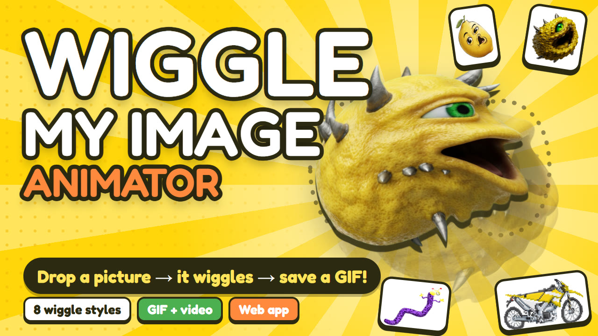

# Wiggle My Image Animator 🍋

Drop in any picture and watch it wiggle. Save it as a looping GIF or video and share it with your friends.

## What is it?

A small web toy that makes pictures wobble, twist and breathe. Pick a picture, and a swirl starts gliding through it along a looping path, so the picture wiggles like jelly. Choose a style, nudge a few sliders, then download the result as a GIF that loops forever (great for chats, memes, stickers and posts) or as a short video clip.

No sign-up, no install, no uploads. Everything happens in your own browser, and your pictures never leave your device.

## Features

- Drop, paste or pick any picture (PNG, JPG, WebP, GIF, and more). Big pictures are shrunk, tiny pixel art stays crisp.
- 8 wiggle styles: Infinity, Figure 8, Circle, Side-side, Up-down, Downhill, Uphill and Breathe. Each button shows the path the wiggle travels along.
- Three friendly sliders: Wiggliness (how twisty), Wander (how far it roams) and Speed (how fast it loops).
- 🎲 Surprise me, for when you can't decide.
- Stay in frame: zooms the picture so no part of it ever wiggles off the edge.
- Backgrounds: see-through, white, black, green screen, magenta, or any colour you like.
- Reverse, Show path, and hold the picture to peek at the original.
- Save as a looping GIF or a video (MP4 or WebM, depending on your browser), in Small, Medium or Large. On phones, Share sends the GIF straight to your apps.
- Light and dark mode, keyboard friendly, and it remembers your settings.

## How to run it

- Online: play it on itch.io at https://reactorcore.itch.io/wiggle-my-image-animator
- Offline: unzip the download and open `index.html` in any modern browser (Chrome, Edge, Firefox, Safari). It works straight from your disk, no server needed. The only thing it fetches online is the rounded title font; without internet it falls back to a standard font.

See [guide.md](guide.md) for a quick how-to and tips.

## Credits and licence

Wiggle My Image Animator and its lemon mascot pictures are made by Reactorcore and released under the MIT licence (see [LICENSE](LICENSE)): you're free to use, change and share it, as long as the licence notice comes along.

It uses two small open-source libraries, both under the MIT licence (their licence notices are kept at the top of each file in `lib/`):

- [glfx.js](https://github.com/evanw/glfx.js) by Evan Wallace, for the WebGL swirl and bulge effects.
- [gifenc](https://github.com/mattdesl/gifenc) by Matt DesLauriers, for making the GIFs.

## Contact

mailto:reactorcoregames@gmail.com

---

Check out everything else I do: ✨🚀

https://linktr.ee/reactorcore

https://reactorcore.itch.io/

-Reactorcore

---

My other links:

- Home/Links: https://linktr.ee/reactorcore
- Releases: https://reactorcore.itch.io
- Blog: https://www.patreon.com/ReactorcoreGames
- Discord: https://discord.gg/UdRavGhj47
- Catalog: https://reactorcoregames.github.io/
